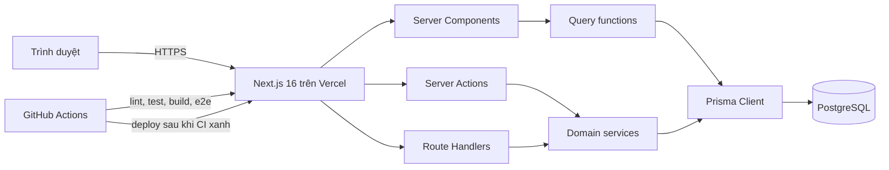
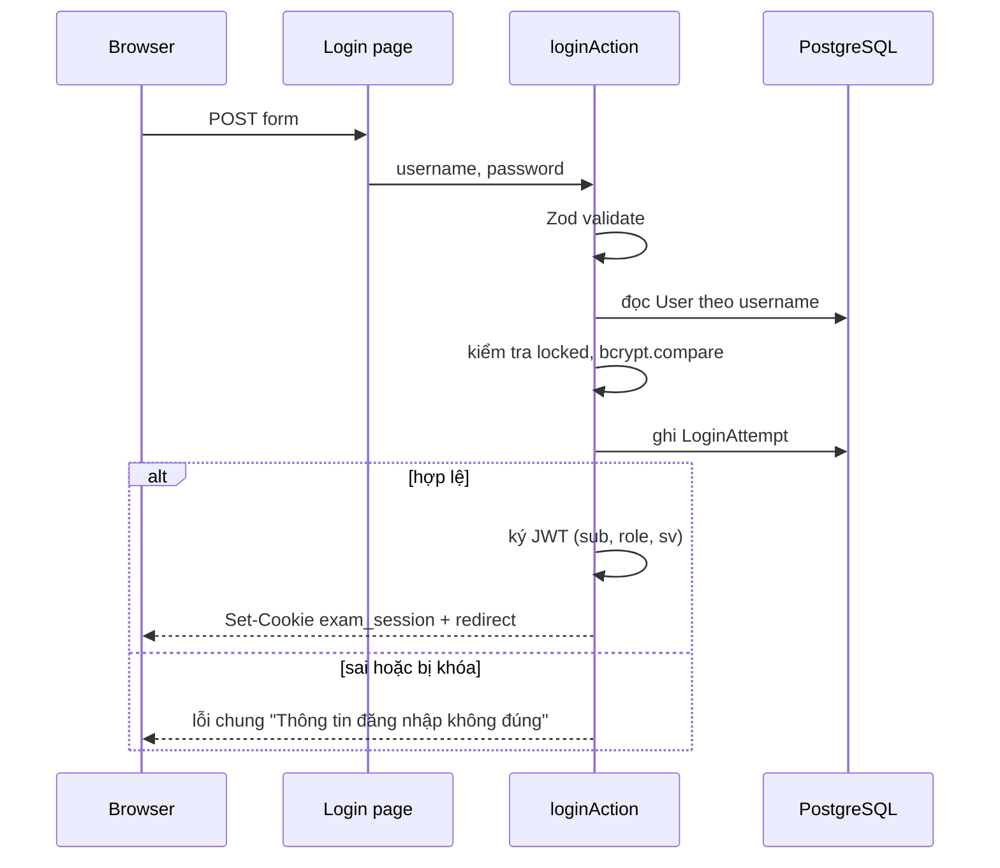
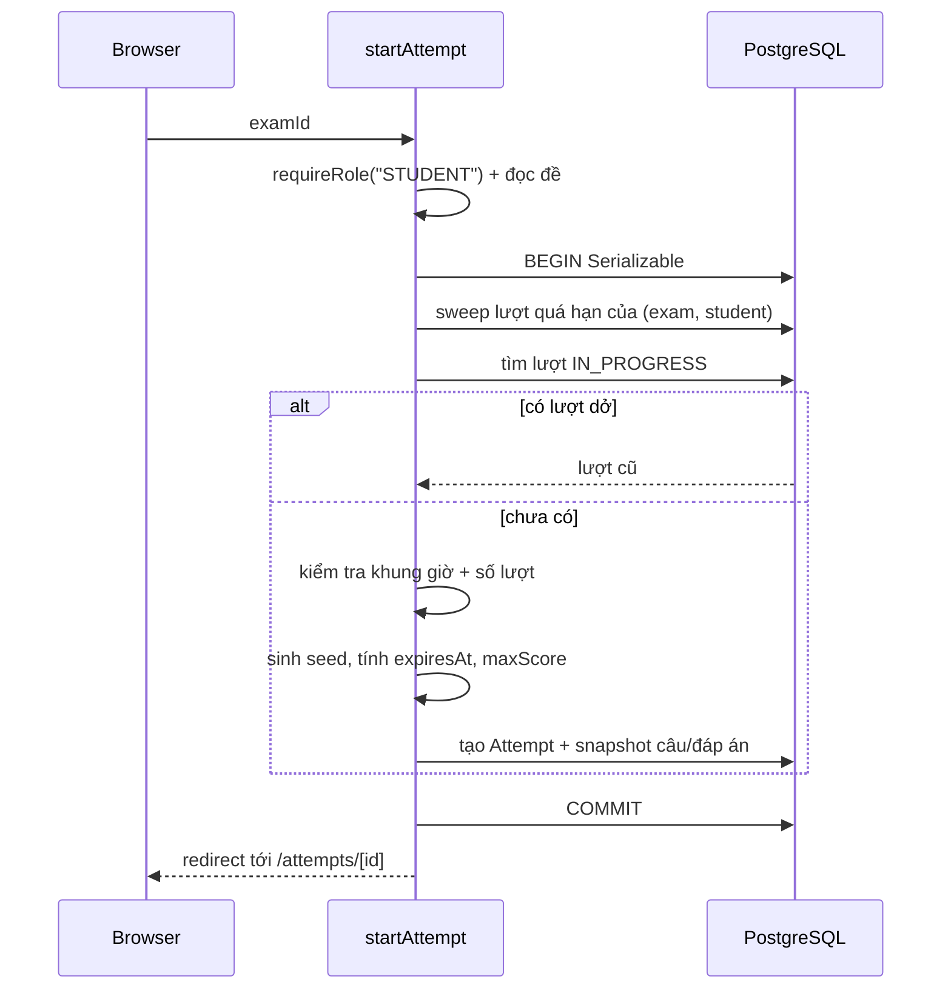
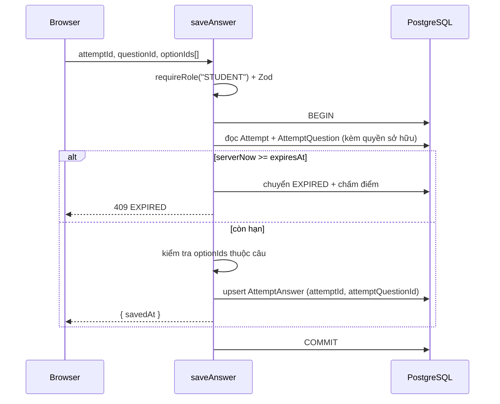

# KIẾN TRÚC — SITE THI TRẮC NGHIỆM ONLINE

> **Trạng thái:** scaffold Next.js 16.4.6 đã có trong repo; Prisma, authentication, test và CI là kế hoạch Mốc 2.
> **Ngày:** 2026-11-26
> **Nguồn quyết định:** [`SPEC.md`](SPEC.md) mục 3. Tài liệu này giải thích **cách** xây, không lặp lại **vì sao** chọn sản phẩm.

---

## 1. Mục đích và giới hạn

Tài liệu này đủ để một lập trình viên khác tiếp tục dự án mà không cần hỏi lại người viết: biết code nằm ở đâu, luồng đi qua những tầng nào, chỗ nào dễ sai và test nào bảo vệ.

**Giới hạn:** scaffold `package.json`, `src/` và script kiểm tra đã có. Prisma, authentication, test hay CI chưa có; các đường dẫn feature dưới đây là đích đến của Mốc 2–4.

---

## 2. Tổng quan hệ thống

Một ứng dụng Next.js duy nhất, deploy trên Vercel, database PostgreSQL. Không có backend REST riêng, không có service thứ hai.



| Thành phần | Vai trò |
|---|---|
| Server Components | Đọc dữ liệu, render HTML; không gửi Prisma object thẳng xuống client |
| Server Actions | Mọi thao tác ghi: đăng nhập, tạo câu hỏi, lưu đáp án, nộp bài |
| Route Handlers | Chỉ dùng cho health check, cron nội bộ (nếu sau này cần) và tệp tải xuống; không dùng làm REST API |
| Query functions | Hàm đọc dữ liệu, đặt trong `src/features/*/queries/` |
| Domain services | Logic thuần và transaction: chấm điểm, xáo trộn, bắt đầu/nộp lượt |
| Prisma | Truy cập PostgreSQL, migration, seed |
| PostgreSQL | Nguồn dữ liệu duy nhất; không dùng SQLite ở bất kỳ môi trường nào |

---

## 3. Công nghệ

### 3.1. Scaffold hiện có

| Thành phần | Phiên bản | Ghi chú |
|---|---|---|
| Next.js | 16.4.6 | App Router; đọc hướng dẫn trong `node_modules/next/dist/docs/` trước khi viết code |
| React | 19.3.0 | Server Components mặc định |
| TypeScript | 5.x, strict | `tsconfig.json`; script `typecheck` |
| Tailwind CSS | 4.3.3 | Mobile-first, token trong `src/app/globals.css` |
| ESLint | 9.x | `eslint-config-next`; script `lint` |
| Prettier | 3.x | `format` và `format:check`; cấu hình trong `.prettierrc` |

### 3.2. Kế hoạch bổ sung

| Thành phần | Phiên bản dự kiến | Vai trò |
|---|---|---|
| Prisma | 7.x | ORM, migration, seed |
| PostgreSQL | 16 | Database cho dev, test, e2e và production |
| Zod | 4.x | Validate input ở server |
| bcryptjs | 3.x | Hash mật khẩu, cost 12 |
| jose | 6.x | Ký và xác minh JWT phiên |
| Vitest | 4.x | Unit và integration test |
| Playwright | 1.x | E2E, quét a11y, chụp màn hình |
| @axe-core/playwright | 4.x | Kiểm tra accessibility |
| @lhci/cli | 0.15.x | Lighthouse CI |
| Prettier | 3.x | Format |

Không thêm thư viện UI lớn. Component dùng Tailwind và HTML gốc để giữ bundle nhỏ và ngữ nghĩa tốt.

---

## 4. Phân tầng

```text
Trình duyệt
  └── src/app/**/page.tsx, layout.tsx        (Server Components)
        ├── src/features/*/queries/*.ts      (đọc)
        └── form + Server Action             (ghi)
              └── src/features/*/actions/*.ts
                    ├── Zod schema
                    ├── getSession / requireRole / assertOwnership
                    ├── domain service (transaction)
                    └── Prisma
                          └── PostgreSQL
```

Quy tắc:

- `src/app` chủ yếu compose feature; không gọi Prisma trực tiếp.
- Client Component chỉ dùng khi cần state, event hoặc browser API. Màn làm bài là Client Component cho phần chọn đáp án và đồng hồ; dữ liệu vẫn do server truyền xuống.
- Không import `@prisma/client` trong file có `"use client"`. Dùng `import "server-only"` ở query/action.
- Không trả nguyên Prisma object qua ranh giới server → client. Luôn map sang DTO.

---

## 5. Bản đồ module

```text
src/
├── app/
│   ├── (auth)/login/page.tsx
│   ├── (student)/
│   │   ├── exams/page.tsx
│   │   └── attempts/[attemptId]/
│   │       ├── page.tsx
│   │       └── result/page.tsx
│   ├── (teacher)/teacher/
│   │   ├── questions/page.tsx
│   │   ├── questions/[questionId]/page.tsx
│   │   ├── exams/page.tsx
│   │   ├── exams/[examId]/page.tsx
│   │   └── exams/[examId]/results/page.tsx
│   ├── (admin)/admin/users/page.tsx
│   └── api/health/route.ts
├── features/
│   ├── auth/          session, login, logout, rate limit
│   ├── users/         admin tạo/khóa/đổi vai trò/đặt lại mật khẩu
│   ├── questions/     ngân hàng câu hỏi, tag, lưu trữ
│   ├── exams/         tạo/sửa đề, danh sách đề cho học viên
│   ├── attempts/      bắt đầu, làm tiếp, lưu, nộp, hết hạn
│   ├── scoring/       hàm chấm thuần, thống kê
│   └── shared/        db, domain types, validation, format ngày/giờ, permission helpers
├── constants/         role, trạng thái, nhãn tiếng Việt
└── proxy.ts           chỉ chuyển hướng UX, không phải lớp phân quyền
```

Mỗi feature tự chứa `components/`, `actions/` (hoặc `actions.ts`), `queries/`, `lib/`, `mocks/` nếu cần; test đặt cạnh code.

---

## 6. Luồng request

### 6.1. Đăng nhập



Rate limit: 5 lần sai / tên đăng nhập / 15 phút và 20 lần sai / IP / 15 phút. Đếm bằng bảng `LoginAttempt`, không dùng bộ nhớ vì Vercel chạy nhiều instance.

### 6.2. Bắt đầu lượt làm



Chốt chặn race: unique `(examId, studentId, attemptNumber)`. Nếu hai transaction cùng tính `attemptNumber`, một bên nhận lỗi unique; action đọc lại lượt đã thắng và trả về lượt đó.

### 6.3. Lưu đáp án



`saveAnswer` **không** trả đáp án đúng, không trả điểm. Chỉ trả `savedAt` và trạng thái lượt.

### 6.4. Nộp bài

```mermaid
sequenceDiagram
    participant B as Browser
    participant A as submitAttempt
    participant DB as PostgreSQL
    B->>A: attemptId
    A->>A: requireRole("STUDENT")
    A->>DB: BEGIN; expireDueAttempts() khóa lượt quá hạn trước
    A->>DB: đọc Attempt + snapshot; chỉ lấy answers có savedAt < expiresAt
    alt status != IN_PROGRESS
        A-->>B: trả điểm đã có (idempotent)
    else còn hạn
        A->>A: scoreAttempt(snapshot, answersLoc)
        A->>DB: updateMany WHERE id AND status=IN_PROGRESS
        A->>DB: ghi awardedPoints/isCorrect cho từng câu
        A-->>B: score, SUBMITTED
    else quá hạn
        A->>A: scoreAttempt(snapshot, answersLoc)
        A->>DB: updateMany WHERE id AND status=IN_PROGRESS → EXPIRED
        A-->>B: score, EXPIRED
    end
    A->>DB: COMMIT
```

`updateMany` có điều kiện trạng thái là trọng tài: chỉ một request thắng. Request thua đọc lại kết quả, không ghi điểm lần hai.

Thứ tự khóa (D-20): `saveAnswer` từ chối mọi ghi có `now >= expiresAt` trong cùng transaction; `expireDueAttempts` chạy trước khi chấm. Bộ lọc chấm điểm là `savedAt < expiresAt`, kể cả khi transaction lưu commit sau hạn. Bắt buộc có integration test fake timer tại ranh giới `expiresAt`: lưu ngay trước hạn được tính, lưu đúng hoặc sau hạn bị từ chối và không vào điểm.

### 6.5. Xem kết quả theo đề (giáo viên)

1. `requireRole("TEACHER")`.
2. Đọc đề; nếu không sở hữu → 404.
3. Sweep lượt quá hạn của đề trước khi tính.
4. Đọc các lượt, join User, sắp xếp theo thời điểm nộp.
5. Trả DTO: tên học viên, trạng thái, điểm, thời điểm nộp.

---

## 7. Xác thực và phân quyền

### 7.1. Phiên

- Cookie tên `exam_session`, chứa JWT HS256 ký bằng `AUTH_SECRET`.
- Payload: `sub` (user id), `role`, `sv` (sessionVersion), `iat`, `exp`.
- Thuộc tính cookie: `httpOnly`, `sameSite=lax`, `secure` ở production, `path=/`, thời hạn 12 giờ.
- `getSession()` xác minh chữ ký, sau đó **đọc lại User** và kiểm tra `locked`, `role`, `sessionVersion`. Không tin payload một mình.
- Khóa, đổi vai trò hoặc đặt lại mật khẩu → tăng `sessionVersion`; phiên cũ bị từ chối ở request kế tiếp.

### 7.2. Kiểm tra quyền

```ts
// src/features/auth/require-role.ts
export async function requireRole(...roles: Role[]) {
  const session = await getSession();
  if (!session) redirect("/login");
  if (!roles.includes(session.role)) notFound();
  return session;
}
```

- Mọi page và Server Action gọi `requireRole` (hoặc `getSession`) ở đầu.
- Bản ghi không thuộc người dùng → `notFound()` (404).
- `src/proxy.ts` chỉ kiểm tra có cookie hợp lệ về hình thức để chuyển hướng sớm; **không** thay thế kiểm tra trong page/action.

### 7.3. Ma trận quyền

Chi tiết ở [`PERMISSIONS.md`](PERMISSIONS.md). Tóm tắt: admin quản lý tài khoản; giáo viên quản lý nội dung của mình; học viên làm bài và xem lượt của mình.

---

## 8. Mô hình thời gian

| Khái niệm | Nơi lưu | Ai đặt |
|---|---|---|
| `Exam.opensAt`, `Exam.closesAt` | PostgreSQL, UTC | Giáo viên nhập giờ địa phương, server đổi sang UTC |
| `Attempt.startedAt` | PostgreSQL, UTC | Server khi bắt đầu |
| `Attempt.expiresAt` | PostgreSQL, UTC | Server: `startedAt + durationMinutes` |
| `serverNow` gửi client | Không lưu | Server mỗi lần render |
| Đồng hồ hiển thị | Client | Tính từ `expiresAt - serverNow`, tick mỗi giây |

- Không dùng giờ client để quyết định hạn.
- Khi tab focus lại: gọi `getAttemptClock(attemptId)` để lấy `serverNow` mới; nếu lệch > 5 giây, cập nhật.
- Hết hạn xử lý lazy (D-06). Hàm `expireDueAttempts(examId?, studentId?)` chạy trong transaction trước các thao tác đọc/ghi liên quan.

---

## 9. Bản chụp, xáo trộn, chấm điểm

### 9.1. Snapshot

Khi bắt đầu, trong một transaction:

1. Tạo `Attempt` với `seed`, `expiresAt`, `maxScore`.
2. Với mỗi `ExamQuestion`, tạo `AttemptQuestion` (nội dung, loại, điểm, thứ tự) và `AttemptOption` (nội dung, thứ tự, `isCorrect`, `sourceOptionId`).
3. Không tạo `AttemptAnswer` cho đến khi học viên chọn.

`AttemptQuestion.sourceQuestionId` là FK nullable, `onDelete: SetNull`; `AttemptOption.sourceOptionId` là chuỗi không FK, dùng cho thống kê sau này.

### 9.2. Xáo trộn

- `seed` là chuỗi hex 32 ký tự (128-bit) từ `crypto.randomBytes(16)`.
- Hàm `shuffle<T>(items: T[], seed: string, salt: string): T[]` dùng PRNG có seed (ví dụ mulberry32) + Fisher–Yates.
- Câu: `shuffle(examQuestions, seed, "questions")`.
- Đáp án câu i: `shuffle(options, seed, "options:" + questionId)`.
- Hàm thuần, không đụng DB; unit test kiểm tra cùng input → cùng output, hai seed khác → thứ tự khác, và mọi phần tử còn đủ.

### 9.3. Chấm điểm

```ts
// src/features/scoring/score-attempt.ts
type SnapshotQuestion = {
  id: string;
  type: "SINGLE" | "MULTI";
  points: number;
  correctOptionIds: string[];
};

export function scoreAttempt(
  questions: SnapshotQuestion[],
  answers: Record<string, string[]>,
): { score: number; maxScore: number; perQuestion: Map<string, boolean> }
```

- Hàm thuần, không async, không Prisma.
- So sánh **tập** ID, không so thứ tự.
- `SINGLE`: `selected.length === 1 && selected[0] === correct[0]`.
- `MULTI`: cùng kích thước và mọi phần tử selected nằm trong correct.
- Không trừ điểm.

---

## 10. Giao dịch và đồng thời

| Thao tác | Cơ chế | Lỗi cần xử lý |
|---|---|---|
| Bắt đầu | `$transaction` isolation `Serializable`, retry một lần khi `P2034`; unique `(examId, studentId, attemptNumber)` | `P2002` → đọc lại lượt đã thắng |
| Lưu đáp án | `upsert` theo `(attemptId, attemptQuestionId)`; kiểm tra hạn trong transaction | Hết hạn → chuyển `EXPIRED`, trả 409 |
| Nộp | `updateMany` với `status = IN_PROGRESS`; chỉ bên thắng ghi điểm | Bên thua đọc lại điểm, không ghi |
| Hết hạn | Cùng guard `updateMany` như nộp | Bên thua bỏ qua |
| Khóa tài khoản | `update` + tăng `sessionVersion` | Không có race đáng kể |

Không dùng khóa trong bộ nhớ. Mọi thứ dựa trên database để đúng khi Vercel scale nhiều instance.

---

## 11. Xử lý lỗi

| Loại | Cách trả |
|---|---|
| Validate | `{ ok: false, fieldErrors: Record<string, string[]> }`; form hiện lỗi từng trường |
| Nghiệp vụ (hết hạn, hết lượt, đề đóng) | `{ ok: false, code: "EXPIRED" \| "NO_ATTEMPTS" \| "CLOSED" }` + thông báo tiếng Việt |
| Không có quyền | `notFound()` → trang 404 |
| Chưa đăng nhập | `redirect("/login")` |
| Lỗi không mong đợi | `error.tsx` + log server; không trả stack trace |

Không hiển thị chi tiết kỹ thuật cho người dùng. Log server có thể kèm `requestId`, `userId`, `attemptId` nhưng không log mật khẩu, token hay nội dung đáp án đúng.

---

## 12. Quyết định kiến trúc

| ID | Quyết định | Lý do |
|---|---|---|
| ADR-01 | Một Next.js app, không backend riêng | Phạm vi nhỏ; Server Components/Actions đủ; giảm vận hành |
| ADR-02 | PostgreSQL ở mọi môi trường, không SQLite | Test đồng thời và transaction phải giống production |
| ADR-03 | Snapshot câu hỏi vào lượt làm | K5; đề đã thi không bị sửa ngược |
| ADR-04 | Seed xáo trộn ở server | K6; tải lại ổn định, không phụ thuộc client |
| ADR-05 | Chấm all-or-nothing | K7; đơn giản, dễ giải thích, dễ test |
| ADR-06 | Hết hạn lazy, không cron | Giảm hạ tầng; kết quả xác định khi truy cập |
| ADR-07 | Lưu trữ câu hỏi thay vì xóa cứng | Bảo toàn đề cũ và K5 |
| ADR-08 | JWT trong cookie + đọc lại DB mỗi request | Thu hồi phiên tức thì; đơn giản hơn session table |
| ADR-09 | bcryptjs thay vì native argon2 | Chạy được trên Vercel không cần build native |
| ADR-10 | Tailwind + HTML gốc, không thư viện UI | Bundle nhỏ, a11y kiểm soát được, mobile-first |

---

## 13. Chưa có / chưa làm

- Chưa có Prisma schema, migration hay seed.
- Chưa có authentication, session, rate limit.
- Chưa có CI, test, Lighthouse.
- Chưa có deploy production; chưa có URL.
- Chưa có import CSV, thống kê câu, lớp học, xem lại bài (Should).
- Chưa có cron; nếu chủ dự án muốn quét hết hạn nền, thêm Route Handler + Vercel Cron ở phiên bản sau.

---

## 14. Tham chiếu

- [`SPEC.md`](SPEC.md) — quyết định sản phẩm, luồng, wireframe.
- [`REQUIREMENTS.md`](REQUIREMENTS.md) — FR/NFR.
- [`ERD.md`](ERD.md) — mô hình dữ liệu.
- [`PERMISSIONS.md`](PERMISSIONS.md) — ma trận quyền.
- [`SECURITY.md`](SECURITY.md) — mối đe dọa và kiểm soát.
