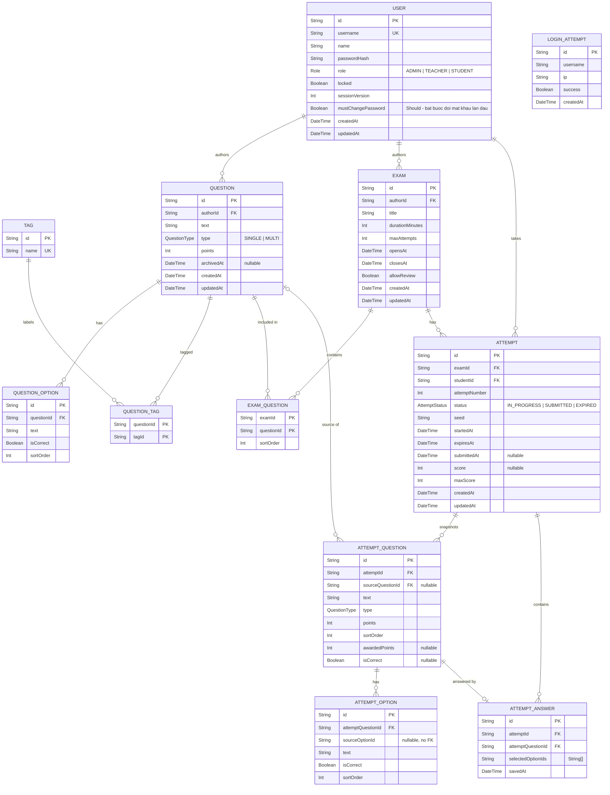

# ERD — SITE THI TRẮC NGHIỆM ONLINE

> **Trạng thái:** Thiết kế dữ liệu cho Mốc 1. Schema Prisma chưa được tạo trong work tree.
> **Ngày:** 2026-11-26
> **Nguồn quyết định:** [`SPEC.md`](SPEC.md) mục 3 và 7.

Sơ đồ dưới đây là mô hình logic cho MVP. Các entity "Should" (lớp học, import CSV) chưa có trong MVP và không nằm trong ERD này.

## Ghi chú thiết kế

### Khóa và ràng buộc

| Ràng buộc | Mục đích |
|---|---|
| `User.username` unique | Không trùng tên đăng nhập |
| `Tag.name` unique | Một tag chỉ có một tên chuẩn hóa |
| `QuestionTag` PK `(questionId, tagId)` | Không gắn trùng tag |
| `ExamQuestion` PK `(examId, questionId)` | Không đưa trùng câu vào đề |
| `ExamQuestion` unique `(examId, sortOrder)` | Thứ tự câu trong đề xác định |
| `Attempt` unique `(examId, studentId, attemptNumber)` | Chốt chặn race khi bắt đầu; không vượt số lượt |
| `AttemptQuestion` unique `(attemptId, sortOrder)` | Thứ tự câu trong lượt xác định |
| `AttemptOption` unique `(attemptQuestionId, sortOrder)` | Thứ tự đáp án trong câu xác định |
| `AttemptAnswer` unique `(attemptId, attemptQuestionId)` | Mỗi câu chỉ có một bản ghi đáp án, upsert ghi đè |

### Index

| Index | Dùng cho |
|---|---|
| `Question(authorId)` | Ngân hàng câu hỏi của giáo viên |
| `Exam(authorId)` | Danh sách đề của giáo viên |
| `Exam(opensAt, closesAt)` | Lọc đề đang mở |
| `Attempt(studentId, examId)` | Đếm lượt, làm tiếp |
| `Attempt(status, expiresAt)` | Quét lượt quá hạn |
| `AttemptQuestion(sourceQuestionId)` | Thống kê theo câu gốc |
| `LoginAttempt(username, createdAt)` | Rate limit theo tên đăng nhập |
| `LoginAttempt(ip, createdAt)` | Rate limit theo IP |

### Xóa và lưu trữ

- `Question` **không xóa cứng** khi đã từng nằm trong đề. `archivedAt` đánh dấu lưu trữ; câu lưu trữ không hiện trong ngân hàng và không thêm được vào đề mới.
- `QuestionOption` xóa theo `Question` (`onDelete: Cascade`) chỉ khi câu bị xóa cứng ngoài luồng nghiệp vụ; bình thường dùng lưu trữ.
- `ExamQuestion.questionId` dùng `onDelete: Restrict` để không mất câu khỏi đề ngoài ý muốn.
- `Attempt` không có thao tác xóa. `AttemptQuestion`, `AttemptOption`, `AttemptAnswer` xóa theo `Attempt` (`Cascade`) nếu sau này có luồng dọn dữ liệu đặc biệt.
- `AttemptQuestion.sourceQuestionId` dùng `onDelete: SetNull`: nếu câu gốc bị xóa cứng, bản chụp vẫn còn.
- `AttemptOption.sourceOptionId` là chuỗi **không có FK**, chỉ để đối chiếu thống kê; bản chụp không phụ thuộc đáp án gốc.
- `User` không xóa; chỉ khóa. `Question.authorId`, `Exam.authorId`, `Attempt.studentId` dùng `onDelete: Restrict`.

### Bản chụp (snapshot)

`ATTEMPT_QUESTION` và `ATTEMPT_OPTION` là bản sao nội dung tại thời điểm bắt đầu:

- `ATTEMPT_QUESTION.text`, `type`, `points`, `sortOrder` lấy từ câu gốc.
- `ATTEMPT_OPTION.text`, `isCorrect`, `sortOrder` lấy từ đáp án gốc.
- `ATTEMPT_OPTION.isCorrect` chỉ dùng ở server để chấm; DTO gửi client bỏ trường này.
- `ATTEMPT_QUESTION.awardedPoints` và `isCorrect` được ghi một lần khi nộp/hết hạn, phục vụ thống kê.

### Thời gian và điểm

- Tất cả `DateTime` lưu UTC.
- `Attempt.startedAt`, `expiresAt`, `submittedAt` do server đặt.
- `Attempt.score` là số nguyên, `null` khi chưa chấm.
- `Attempt.maxScore` là tổng điểm snapshot tại thời điểm bắt đầu, không đổi nếu đề bị sửa sau đó.
- `Attempt.attemptNumber` bắt đầu từ 1, tăng theo số lượt đã dùng.

### Dữ liệu Should (chưa có trong MVP)

- `Class`, `ClassMember`, `ExamClass` cho FR-27.
- Bảng theo dõi import CSV nếu cần báo lỗi theo dòng.
- Không thêm các bảng này vào migration MVP; chỉ thêm khi làm tính năng Should.

### Vị trí schema dự kiến

- `prisma/schema.prisma` — schema chung.
- `prisma/migrations/` — migration PostgreSQL.
- `prisma/seed.ts` — dữ liệu demo local/test.
- `prisma/seed-production.ts` — dữ liệu demo production, không tạo tài khoản thật.
