# Mockup ứng dụng Trắc nghiệm (Figma Design)

**File Figma:** https://www.figma.com/design/WAj9m3ZxAJY8AewIoUc535/Exam-App---Mobile-Mockup?node-id=0-1

Tài liệu này mô tả các mockup được dựng theo `docs/SPEC.md` mục 10 (wireframe mobile-first), mở rộng sang desktop, kèm trạng thái lỗi/empty và màn hình đăng nhập.

## Phạm vi

Tổng 22 frame trên page `Exam App · Mobile`:

| Nhóm | Frame | Kích thước |
|---|---|---|
| Mobile (dựng qua Figma MCP) | `01 · Danh sách đề`, `02 · Làm bài`, `03 · Kết quả`, `04 · Ngân hàng câu hỏi`, `05 · Tạo đề` | 360×800 |
| Overlay mobile | `02b · Danh sách câu`, `02c · Xác nhận nộp bài` | 360×800 |
| Desktop học viên | `D1 · Danh sách đề`, `D2 · Làm bài + danh sách câu`, `D3 · Kết quả`, `D6 · Điểm có ngay, đáp án chờ mở` | 1440×900 |
| Desktop giáo viên | `D4 · Ngân hàng câu hỏi`, `D5 · Tạo đề` | 1440×900 |
| Đăng nhập | `L1 · Đăng nhập (desktop)`, `L2 · Đăng nhập (mobile)` | 1440×900 / 360×800 |
| Trạng thái/phụ | `S1`–`S7` (trong đó `S6` là 404, `S7` là đáp án chờ mở) | 360×800 |

Wireframe ASCII trong [`SPEC.md`](SPEC.md) mục 10 là bản trình duyệt, chờ mentor duyệt. File Figma ở đây là tài liệu trực quan **tùy chọn**, không thay thế wireframe.

## Ảnh mockup

Ảnh export từ Figma desktop, lưu trong `docs/mockups/`. Đây là bản đối chiếu trực quan với wireframe trong [`SPEC.md`](SPEC.md) mục 10.

### Mobile

| Frame | Ảnh |
|---|---|
| `01` Danh sách đề | 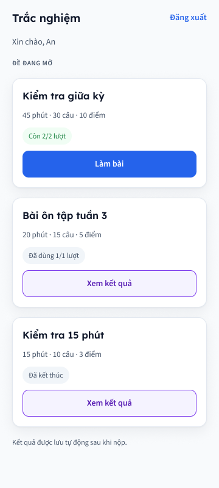 |
| `02` Làm bài | 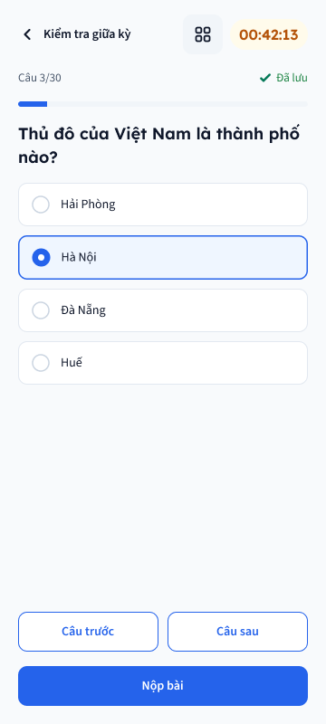 |
| `02b` Danh sách câu | 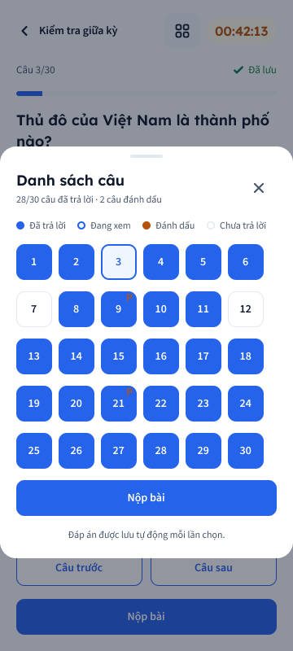 |
| `02c` Xác nhận nộp bài | 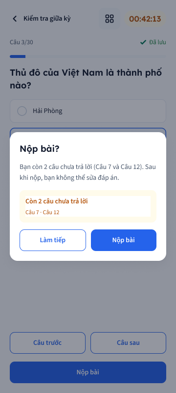 |
| `03` Kết quả | 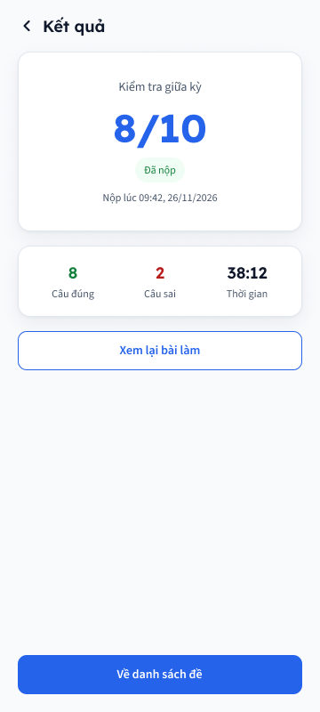 |
| `04` Ngân hàng câu hỏi | 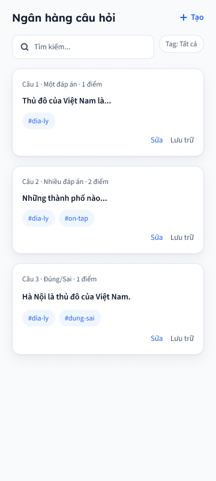 |
| `05` Tạo đề | 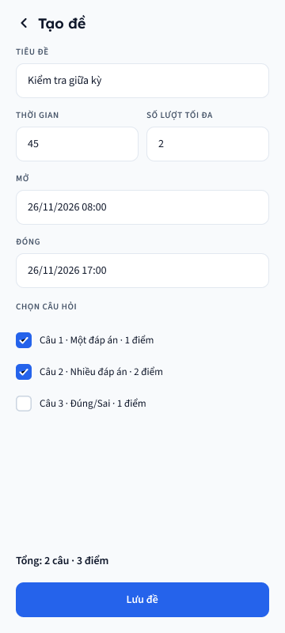 |
| `L2` Đăng nhập mobile | 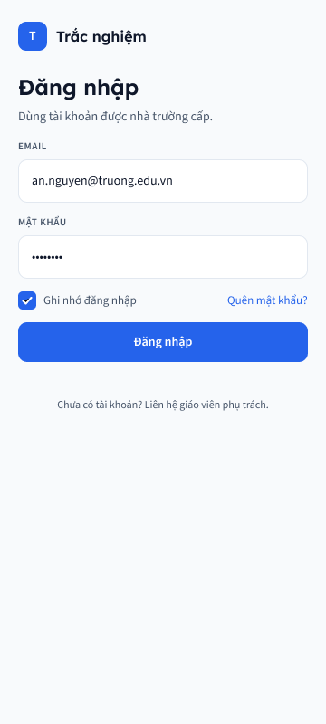 |

### Desktop

| Frame | Ảnh |
|---|---|
| `D1` Danh sách đề | 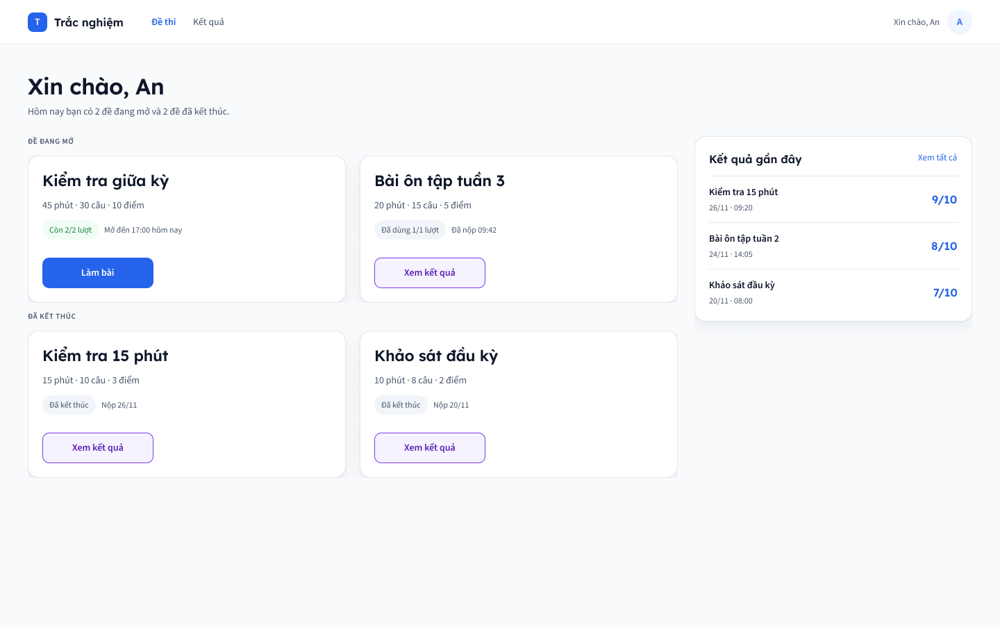 |
| `D2` Làm bài | 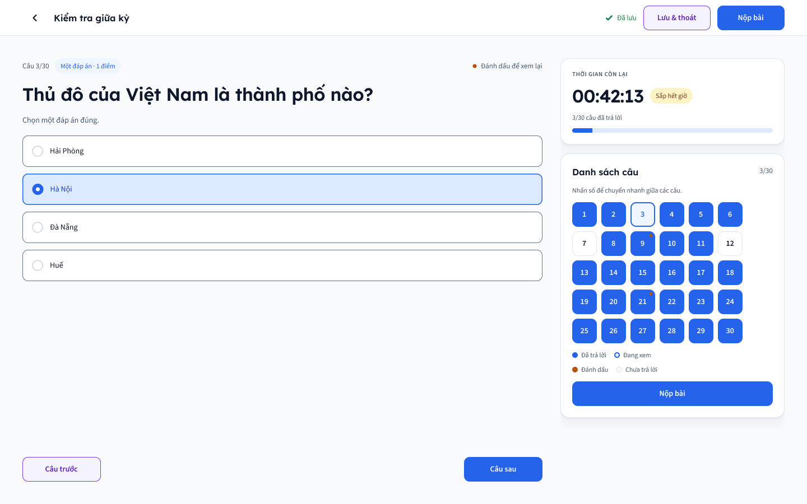 |
| `D3` Kết quả | 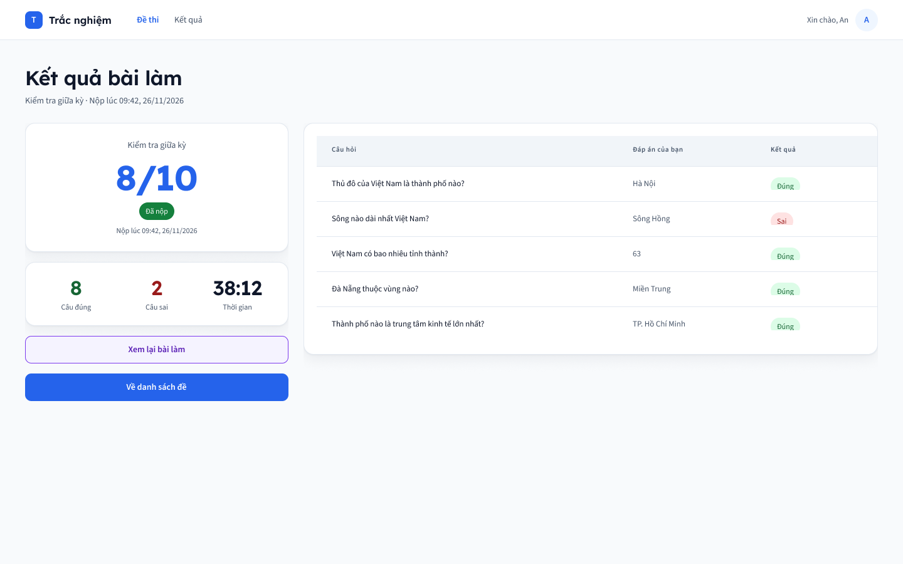 |
| `D4` Ngân hàng câu hỏi | 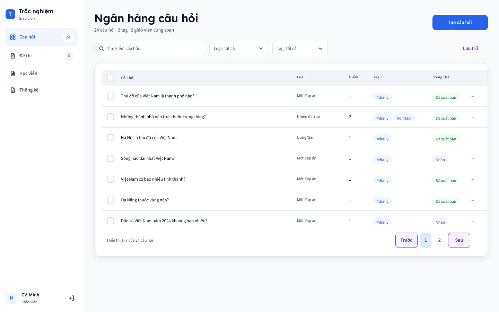 |
| `D5` Tạo đề | 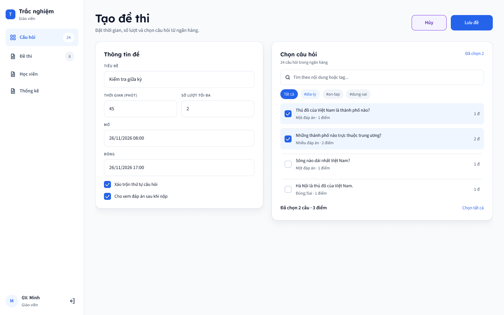 |
| `D6` Điểm có ngay | 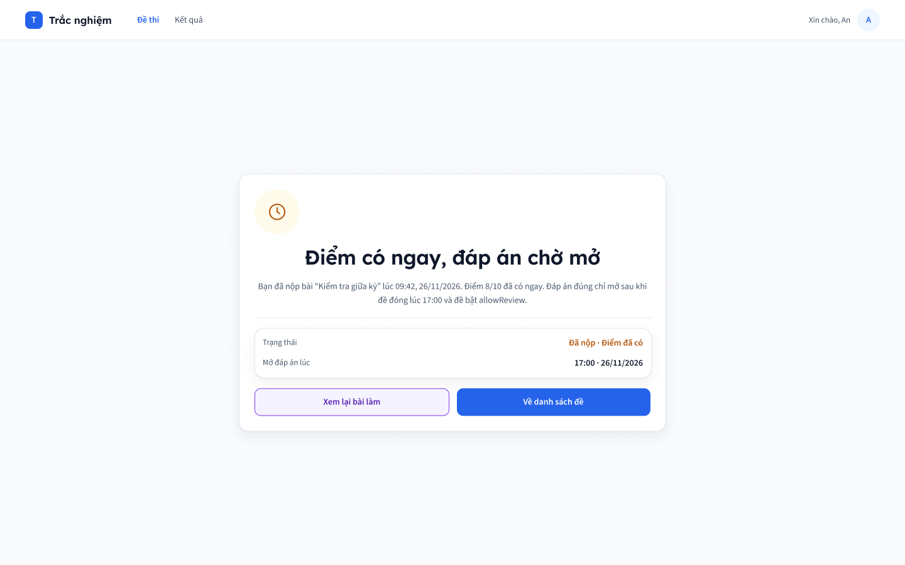 |
| `L1` Đăng nhập desktop | 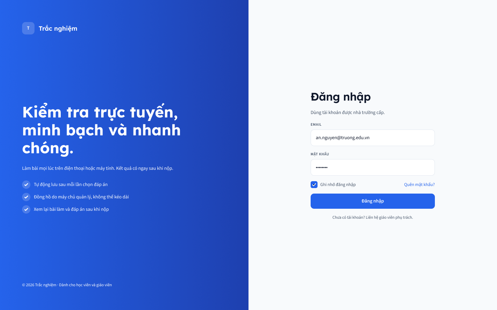 |

### Trạng thái

| Frame | Ảnh |
|---|---|
| `S1` Danh sách trống | 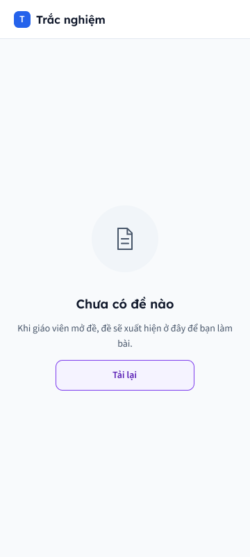 |
| `S2` Ngân hàng trống | 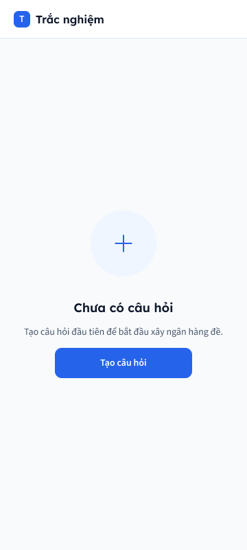 |
| `S3` Lỗi tải | 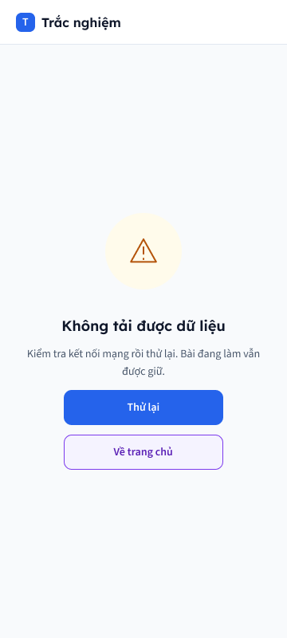 |
| `S4` Mất mạng | 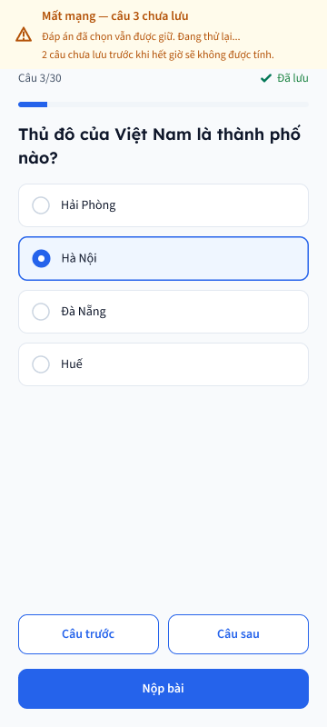 |
| `S5` Hết giờ | 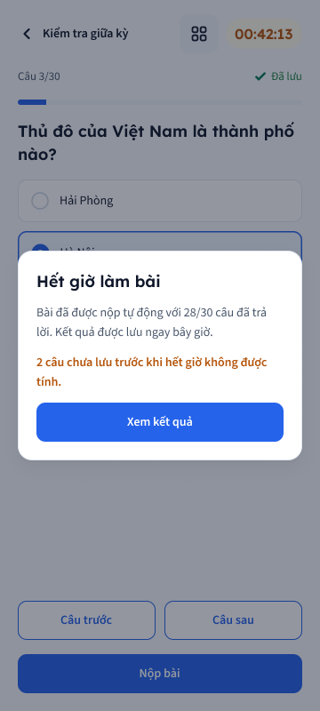 |
| `S6` 404 | 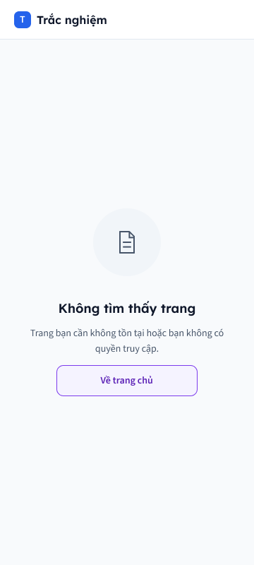 |
| `S7` Đáp án chờ mở | 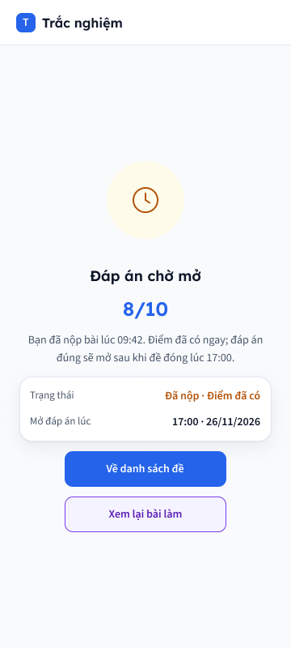 |

A-R1 và A-R9 đã xử lý: S6 dùng chung một nội dung "Không tìm thấy trang" cho mọi trường hợp (id lạ, bản ghi người khác, sai vai trò), không tiết lộ lý do; S7 hiện `8/10`. Nút "Xem lại bài làm" khi đáp án còn khóa chỉ hiện đáp án đã chọn, không hiện đúng/sai (FR-26).

### Color palette

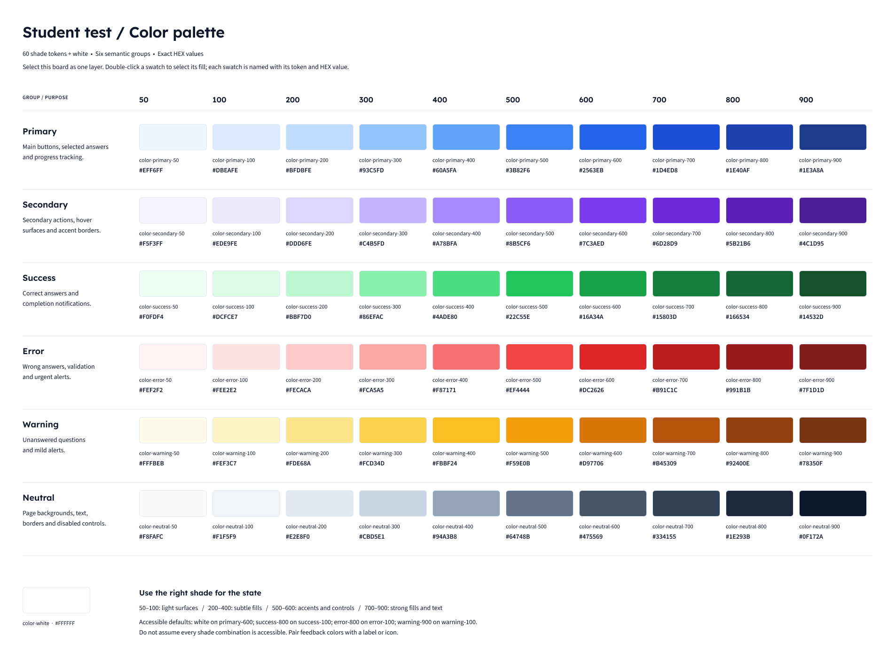

---

## Hành vi chính

- **Điều hướng nhanh giữa các câu:** trên mobile mở bottom sheet từ nút lưới trên thanh làm bài; trên desktop là sidebar phải luôn hiển thị. Grid 30 nút 44×44, 4 trạng thái: đã trả lời (xanh đặc), đang xem (viền xanh + nền xanh nhạt), chưa trả lời (xám), đánh dấu (chấm cam).
- **Nộp bài:** nút Nộp bài mở dialog xác nhận, cảnh báo "Còn 2 câu chưa trả lời (Câu 7 và Câu 12)" với hai lựa chọn "Làm tiếp" / "Nộp bài". Theo SPEC, confirmation chỉ bắt buộc khi còn câu trống.
- **Điểm và đáp án đúng:** điểm hiện ngay sau khi nộp (FR-23). `D6` / `S7` minh họa đề chưa đóng nhưng điểm đã có; chỉ **đáp án đúng** bị khóa đến khi đề đóng và bật `allowReview` (FR-26, D-11, D-19). Trạng thái hiển thị: "Đã nộp · Điểm đã có · Chờ mở đáp án".
- **Trạng thái còn lại:** danh sách đề trống, ngân hàng trống, lỗi tải + Thử lại, mất mạng (SPEC §10.2: "Mất mạng — câu 3 chưa lưu. Đáp án đã chọn vẫn được giữ."), hết giờ tự nộp, 404 khi không có quyền (D-15).

## Design tokens

| Nhóm | Giá trị |
|---|---|
| Primary / hover / soft | `#2563EB` / `#1D4ED8` / `#EFF6FF` |
| Background / surface / border | `#F8FAFC` / `#FFFFFF` / `#E2E8F0` |
| Foreground / muted | `#0F172A` / `#475569` |
| Success / danger / warning (+ soft) | `#15803D` / `#B91C1C` / `#B45309` |
| Accent | `#D97706` (warning-600) |
| Heading | Lexend (Display 44/56, H1 24/32, H2 18/26, H3 16/24) |
| Body | Source Sans 3 (14/22, 13/20, 12/18, 11/16) |
| Elevation | `Exam/Card Shadow` — shadow 2 lớp cho card |

Nguồn màu là board **Student test / Color palette** trong Figma: 60 shade token (`color-{group}-{50..900}`) cộng `color-white`. Builder tạo paint style cho từng token và dùng các cặp màu đã kiểm tra WCAG AA; không chép lại bảng tỉ lệ contrast vào đây.

Ánh xạ trạng thái:

| Thành phần | Mặc định | Đang chọn / hover | Phản hồi |
|---|---|---|---|
| Đáp án | trắng, chữ neutral-900, viền neutral-500 | nền primary-100, chữ primary-800, viền primary-600 | đúng: success-100/800; sai: error-100/800; chưa trả lời: warning-100/900 |
| Nút chính | primary-600, chữ trắng | primary-700 | primary-800 khi nhấn |
| Nút phụ | secondary-50, chữ secondary-800, viền secondary-600 | secondary-100 | secondary-200 khi nhấn |
| Thanh tiến độ | track primary-100 | fill primary-600 | nhãn neutral-900 đặt ngoài thanh |
| Thông báo | — | — | hoàn tất: success-700/chữ trắng; lỗi: error-700/chữ trắng |
| Focus | viền 2 px primary-600, đệm trắng 2 px | — | — |

Giữ đáp án đã chọn màu xanh; dùng xanh lá/đỏ chỉ sau khi nộp, và luôn kèm chữ hoặc icon, không dùng màu đơn thuần.

D5 hiển thị gợi ý giới hạn trên ngay trên nhãn trường (thời gian, số lượt, số câu). Đề không được chọn nhiều câu hơn số câu đang có trong ngân hàng. Giá trị cụ thể là nguồn duy nhất tại [`REQUIREMENTS.md`](REQUIREMENTS.md) mục 5; server validate, mockup chỉ nhắc người dùng, không tự định nghĩa lại giới hạn.

17 paint styles, 14 text styles và 1 effect style được tạo trong file. Do chế độ `documentAccess: dynamic-page` của plugin, các node dùng **giá trị thuộc tính trực tiếp** (`fills`, `strokes`, `fontName`, `effects`) thay vì liên kết style; style vẫn có sẵn trong file để dùng lại.

## Khả năng tiếp cận (theo SPEC §10)

- Vùng bấm tối thiểu 44×44 px; radio/checkbox giữ ngữ nghĩa gốc.
- Không cuộn ngang ở 360 px; thao tác bằng bàn phím đầy đủ.
- Đồng hồ dùng `aria-live="polite"`, chỉ đọc khi còn 5 phút và 1 phút.
- Trạng thái "Đã lưu"/"Chưa lưu" có cả màu và chữ, không chỉ dựa vào màu.

## Tái tạo mockup

File Figma là tham khảo trực quan; người clone repo **không thể tự dựng lại** các frame từ repo vì plugin được giữ ngoài git (`.gitignore` chứa `/figma-plugin/`). Plugin này chỉ tồn tại trên máy tác giả, không phải artifact của dự án.

Nếu cần chỉnh sửa, làm trực tiếp trong file Figma được link ở đầu tài liệu. Không coi plugin local là nguồn thiết kế; nguồn để duyệt vẫn là wireframe trong `SPEC.md` mục 10.

**Lưu ý:** tài khoản Figma Starter có hạn mức 20 lượt gọi MCP/tháng và đã hết quota trong phiên làm việc; `figma-unlimited-mcp` chỉ hỗ trợ FigJam (`editorType: ["figjam"]`), không thay thế được việc dựng frame Design.
