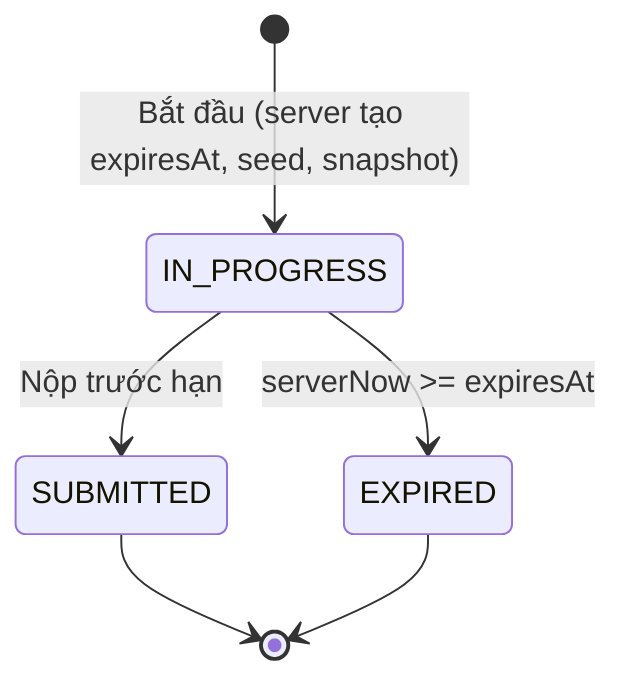

# ĐẶC TẢ SẢN PHẨM — SITE THI TRẮC NGHIỆM ONLINE

> **Trạng thái:** Bản nháp Mốc 1, chờ mentor duyệt. Chưa có mã tính năng.
> **Ngày:** 2026-11-26
> **Nguồn:** `Software Requirements Specification Online Multiple-Choice Exam Site.md` (SRS v0.1) và brief `de-bai-site-trac-nghiem.html`.
> **Tài liệu liên quan:** [`REQUIREMENTS.md`](REQUIREMENTS.md), [`ARCHITECTURE.md`](ARCHITECTURE.md), [`ERD.md`](ERD.md), [`PERMISSIONS.md`](PERMISSIONS.md), [`SECURITY.md`](SECURITY.md).

Tài liệu này là nguồn sự thật cho **sản phẩm**: bài toán, phạm vi, quyết định, luồng, vòng đời lượt làm, luật chấm và tiêu chí nghiệm thu. Danh mục FR/NFR chi tiết nằm ở `REQUIREMENTS.md`; quyết định kỹ thuật nằm ở `ARCHITECTURE.md`.

---

## 1. Bài toán

Một trung tâm đào tạo đang tổ chức thi trắc nghiệm trên giấy: in đề, chấm tay, nhập điểm vào Excel. Mỗi đợt thi mất 2–3 ngày mới có kết quả, và trung tâm không biết câu nào quá dễ hay quá khó.

Website cần giải quyết ba việc:

1. Giáo viên soạn câu hỏi một lần, dùng lại cho nhiều đề.
2. Học viên làm bài online có giới hạn thời gian, trên điện thoại hoặc máy tính.
3. Hệ thống tự chấm ngay khi nộp và thống kê kết quả theo đề, theo câu hỏi.

Điều trung tâm lo nhất:

- **Gian lận:** xem được đáp án, kéo dài thời gian, làm lại quá số lần cho phép.
- **Mất bài:** mạng chập chờn, tải lại trang, đóng tab.

Vì vậy bốn tính chất không thể thương lượng là: **không lộ đáp án (K1)**, **thời gian do server quyết định (K2)**, **trạng thái lượt làm rõ ràng (K3)** và **không mất bài (K4)**. Thiếu một trong bốn tính chất K1–K4 thì hệ thống không dùng được trong thực tế.

---

## 2. Người dùng và phạm vi

### 2.1. Vai trò

| Vai trò | Bắt buộc (Must) | Nên có (Should) | Không làm (Out) |
|---|---|---|---|
| Giáo viên | Ngân hàng câu hỏi một đáp án và nhiều đáp án, có tag chủ đề. Tạo đề: chọn câu, thời gian làm bài, số lần làm tối đa, khung giờ mở đề. Xem kết quả theo đề | Import câu hỏi từ CSV. Thống kê từng câu: tỉ lệ trả lời đúng, đáp án sai hay bị chọn nhất | Câu tự luận, chấm tay, câu có hình/công thức |
| Học viên | Danh sách đề đang mở. Làm bài có đồng hồ đếm ngược, tự lưu, nộp bài, xem điểm ngay | Xem lại bài kèm đáp án đúng (nếu đề cho phép, sau khi đề đóng) | Thi có giám sát camera, chống chụp màn hình |
| Admin | Tạo tài khoản, gán vai trò, khóa tài khoản | Gán học viên vào lớp, đề chỉ mở cho một lớp | Đăng ký tự do, thanh toán, đăng nhập mạng xã hội |

### 2.2. Ranh giới

**Trong phạm vi MVP:**

- Đăng nhập, đăng xuất, phân quyền server-side.
- Admin quản lý tài khoản (tạo, đổi vai trò, khóa, đặt lại mật khẩu).
- Giáo viên quản lý câu hỏi và đề của mình.
- Học viên làm bài, tự lưu, nộp, xem điểm.
- Chấm điểm tự động và lưu kết quả bất biến.

**Ngoài phạm vi, kể cả khi còn thời gian:**

- Câu tự luận, chấm tay, câu có hình ảnh hoặc công thức.
- Giám sát camera, chống chụp màn hình, phát hiện chuyển tab.
- Đăng ký tự do, đăng nhập mạng xã hội, thanh toán.
- Chỉnh sửa điểm đã nộp (regrade).
- Xóa cứng đề hoặc lượt làm.

---

## 3. Quyết định đã chốt

Các quyết định dưới đây thay cho những mục "TBD" trong SRS. Chúng được ghi kèm lý do để mentor kiểm tra.

| ID | Quyết định | Lý do | Liên quan |
|---|---|---|---|
| D-01 | **K7 — câu nhiều đáp án: đúng hết mới có điểm (all-or-nothing), không trừ điểm.** | Dễ hiểu, dễ hiển thị trước giờ thi, dễ kiểm thử bằng bảng. Trung tâm lo gian lận và mất bài hơn là điểm từng phần; chấm từng phần tạo tranh cãi khiếu nại. | K7, FR-22 |
| D-02 | **Giáo viên chỉ sửa nội dung do mình tạo.** | Cùng mô hình với SRS; tránh ghi đè chéo giữa giáo viên. | K8, FR-05, FR-11 |
| D-03 | **Không chấm lại bài đã nộp.** Sửa câu hỏi không làm đổi điểm cũ. | Bảo đảm K5 và tính công bằng giữa các đợt. Regrade sẽ là tính năng riêng nếu chủ dự án yêu cầu. | K5, FR-08, FR-22 |
| D-04 | **Tự lưu ngay khi học viên chọn đáp án**, không chờ theo lô. | Yêu cầu K4 nhấn mạnh "ngay khi chọn"; lô ngắn làm tăng cửa sổ mất dữ liệu. | K4, FR-17 |
| D-05 | **Tài khoản do admin tạo.** Mật khẩu tối thiểu 8 ký tự, hash bcrypt cost 12. Không có email tự đặt lại; admin đặt lại mật khẩu. Cờ `mustChangePassword` là Should. | Không có hạ tầng email trong phạm vi; admin là người quản lý tài khoản. | FR-03, FR-04 |
| D-06 | **Hết hạn được xử lý lazy** khi lượt làm được truy cập (danh sách đề, bắt đầu, làm tiếp, lưu, nộp, xem kết quả). Không dùng cron trong MVP. | Vercel Cron tần suất phút cần gói trả phí; lazy sweep cho kết quả xác định và đủ cho quy mô trung tâm. | K2, FR-21 |
| D-07 | **`closesAt` chỉ chặn bắt đầu.** Lượt đã bắt đầu trước giờ đóng vẫn có đủ thời lượng. | Tránh cắt bài của học viên vào muộn một cách không báo trước; quy tắc đơn giản để hiển thị. | FR-10, FR-15 |
| D-08 | **Xóa câu hỏi = lưu trữ (`archivedAt`), không xóa cứng.** Câu đã lưu trữ biến mất khỏi ngân hàng và không thêm được vào đề mới, nhưng đề cũ vẫn dùng được. | Giữ K5 và tránh làm hỏng đề đã tạo; không cần xóa dây chuyền phức tạp. | K5, FR-09 |
| D-09 | **Admin chỉ quản lý tài khoản**, không sửa câu hỏi/đề. | Nguyên tắc quyền tối thiểu; nội dung thi thuộc giáo viên. | K8, FR-03, FR-04 |
| D-10 | **Lưu thời gian bằng UTC; hiển thị theo `Asia/Ho_Chi_Minh` (UTC+7).** | Server Vercel chạy UTC; người dùng Việt Nam đọc giờ địa phương. | FR-10, FR-21 |
| D-11 | **Xem lại đáp án đúng chỉ sau khi đề đóng và đề bật `allowReview`.** | Không làm lộ đáp án cho lượt làm khác; đúng tinh thần K1. | K1, FR-26 |
| D-12 | **Không có xóa đề trong MVP.** Giáo viên chỉ sửa đề; đề sai có thể đóng bằng `closesAt`. | Giảm bề mặt lỗi và bảo toàn lượt làm; xóa mềm là Should của phiên bản sau. | FR-11 |
| D-13 | **Đang có lượt `IN_PROGRESS` thì "Bắt đầu" là làm tiếp**, không tạo lượt mới và không tính thêm lượt. | Tránh mất lượt do tải lại trang hoặc mở hai tab. | K3, K4, FR-15, FR-18 |
| D-14 | **Phiên đăng nhập 12 giờ**, cookie `httpOnly`, `sameSite=lax`, `secure` ở production. Khóa/đổi vai trò/đặt lại mật khẩu tăng `sessionVersion` để hủy phiên ngay request kế tiếp. | Đủ dài cho một buổi thi; thu hồi được quyền khi cần. | K8, FR-01, FR-04 |
| D-15 | **Truy cập bản ghi không có quyền trả 404**, không trả 403. Chưa đăng nhập thì chuyển về trang đăng nhập. | Không tiết lộ sự tồn tại của bản ghi; đúng yêu cầu K8. | K8, FR-05 |
| D-16 | **Đồng hồ trên màn hình chỉ để hiển thị.** Server trả `expiresAt` và `serverNow`; client đếm ngược, đồng bộ lại khi tab được focus. | K2: đổi giờ máy, sửa JS hoặc gửi request muộn đều không kéo dài được thời gian. | K2, FR-15, FR-17 |
| D-17 | **Thứ tự câu và đáp án sinh từ `seed` lưu ở server**, không xáo ở client. | K6: ổn định khi tải lại, khác nhau giữa các lượt, chấm điểm theo ID đáp án nên không phụ thuộc thứ tự. | K6, FR-15, FR-16 |
| D-18 | **Điểm và đáp án đúng không bao giờ gửi xuống trình duyệt trong lúc làm bài.** DTO của lượt làm chỉ có nội dung câu, ID đáp án, thứ tự, thời gian còn lại. | K1: ẩn bằng CSS hoặc kiểm tra ở client là không đủ. | K1, FR-16 |
| D-19 | **Điểm hiện ngay sau khi nộp; chỉ đáp án đúng bị khóa đến khi đề đóng và bật `allowReview`.** **Chờ mentor xác nhận.** | FR-23 là Must. Giữ điểm đến lúc đóng đề là thay đổi Must, phải xin mentor; xem lại đáp án là Should (FR-26, D-11). Mockup D6/S7 đi theo hướng này nhưng chưa có bằng chứng duyệt. | FR-23, FR-26, D-11 |
| D-20 | **Khi chấm, chỉ tính đáp án có `savedAt < expiresAt`; `expireDueAttempts` khóa lượt trước, `saveAnswer` bị từ chối sau hạn trong cùng transaction.** | K2: request lưu có thể commit sau hạn; lọc theo thời gian lưu thực tế tránh cộng điểm sai. | K2, FR-17, FR-21, FR-22 |
| D-21 | **Hàng đợi offline lưu trong IndexedDB theo `attemptId`, gồm lựa chọn và `currentQuestionIndex`; khôi phục khi có mạng hoặc khi tải lại. K2 thắng K4: đáp án chọn lúc offline nhưng đẩy lên sau `expiresAt` không được tính; UI phải báo "N câu chưa lưu trước khi hết giờ không được tính". Xóa hàng đợi của `attemptId` khi lượt `SUBMITTED`/`EXPIRED` hoặc khi đăng xuất.** | K4: mất mạng rồi reload sẽ mất đáp án nếu chỉ giữ trong bộ nhớ; K2: không để hàng đợi hợp thức hóa đáp án gửi muộn. Quy tắc phải hiển thị, không được là hành vi ngầm. | K2, K4, FR-17, FR-19, FR-21 |

---

## 4. Luồng nghiệp vụ

### 4.1. Admin

1. Đăng nhập bằng tài khoản admin.
2. Tạo tài khoản: họ tên, tên đăng nhập, mật khẩu ban đầu, vai trò (giáo viên/học viên/admin).
3. Đổi vai trò hoặc khóa tài khoản. Không được khóa/hạ vai trò admin đang hoạt động cuối cùng.
4. Đặt lại mật khẩu khi người dùng quên. Không có luồng email tự phục vụ.
5. Đăng xuất.

### 4.2. Giáo viên

1. Đăng nhập.
2. Tạo câu hỏi: nội dung, loại (một/nhiều đáp án), 2–6 đáp án, đáp án đúng, điểm, tag chủ đề.
3. Lọc ngân hàng câu hỏi theo tag; chỉ thấy câu của mình.
4. Sửa câu hỏi. Nếu câu đã nằm trong lượt làm, bản chụp của lượt làm không đổi.
5. Lưu trữ câu hỏi không còn dùng. Câu đã lưu trữ không hiện trong ngân hàng và không thêm được vào đề mới.
6. Tạo đề: tiêu đề, chọn câu, thời gian làm bài, số lượt tối đa, khung giờ mở/đóng.
7. Sửa đề. Đề đã có lượt làm vẫn giữ nguyên bản chụp của các lượt đó.
8. Xem kết quả theo đề: từng học viên, trạng thái, điểm, thời điểm nộp.

### 4.3. Học viên

1. Đăng nhập.
2. Xem danh sách đề đang mở trong khung giờ và còn lượt.
3. Bắt đầu hoặc làm tiếp lượt đang dở.
4. Làm bài: đồng hồ đếm ngược, chọn đáp án, tự lưu, chỉ báo câu chưa lưu khi mất mạng.
5. Nộp bài trước hạn, hoặc bị chuyển `EXPIRED` khi hết giờ.
6. Xem điểm ngay sau khi nộp.
7. (Should) Xem lại bài kèm đáp án đúng nếu đề cho phép và đã đóng.

---

## 5. Vòng đời lượt làm (Attempt)



Quy tắc bất biến:

- Chỉ có hai chuyển trạng thái hợp lệ từ `IN_PROGRESS`: sang `SUBMITTED` hoặc `EXPIRED`.
- `SUBMITTED` và `EXPIRED` là trạng thái cuối. Không quay lại `IN_PROGRESS`.
- Mỗi lượt có **đúng một** bản ghi điểm. Nộp lặp, nộp ở hai tab, hoặc nộp sau hạn không tạo điểm thứ hai.
- Số lượt đã dùng = số bản ghi `Attempt` của cặp (đề, học viên), gồm cả `SUBMITTED` và `EXPIRED`.
- Nếu đang có `IN_PROGRESS`, thao tác bắt đầu trả về chính lượt đó (làm tiếp), không tăng số lượt.
- Hai request bắt đầu đồng thời không được vượt `maxAttempts`; ràng buộc unique `(examId, studentId, attemptNumber)` là chốt chặn cuối.

---

## 6. Thời gian

**Nguyên tắc:** server là nguồn thời gian duy nhất.

- Khi bắt đầu, server ghi `startedAt = now()` và `expiresAt = startedAt + durationMinutes`.
- `closesAt` chỉ được kiểm tra ở thời điểm bắt đầu. Lượt đã bắt đầu có đủ thời lượng kể cả khi vượt `closesAt`.
- Client nhận `expiresAt` và `serverNow` (ISO 8601). Đồng hồ hiển thị = `expiresAt - serverNow - elapsedClient`, cập nhật mỗi giây.
- Khi tab được focus lại hoặc `visibilitychange`, client gọi lại server để lấy `serverNow` và đồng bộ; nếu lệch quá 5 giây thì dùng giá trị server.
- Mọi thao tác ghi (lưu đáp án, nộp) kiểm tra `serverNow >= expiresAt` **trong transaction**. Request đến sau hạn bị từ chối, kể cả khi client sửa giờ máy hoặc gửi tay.
- Lượt quá hạn được chuyển `EXPIRED` và chấm điểm theo các đáp án có `savedAt < expiresAt`, tại lần truy cập kế tiếp (D-06, D-20). Các trigger: danh sách đề, bắt đầu, làm tiếp, lưu, nộp, xem kết quả của học viên, xem kết quả của giáo viên.
- Đồng hồ không dùng `setInterval` để quyết định nộp bài; chỉ dùng để hiển thị. Việc nộp do người dùng bấm hoặc do server phát hiện quá hạn.

---

## 7. Xáo trộn và bản chụp (snapshot)

### 7.1. Xáo trộn (K6)

- Mỗi lượt có `seed` ngẫu nhiên 128-bit, sinh bằng `crypto.randomBytes`, lưu ở server.
- Thứ tự câu và thứ tự đáp án sinh bằng Fisher–Yates với PRNG có seed (hàm thuần, có unit test).
- Đáp án được xáo trong từng câu, không xáo toàn bộ danh sách đáp án của đề.
- Tải lại trang dùng lại đúng `seed` nên thứ tự không đổi. Hai lượt khác nhau có seed khác nên thứ tự khác nhau (kiểm thử bằng hai lượt).
- Chấm điểm dựa trên **ID đáp án**, không dựa trên vị trí, nên xáo thứ tự không làm sai điểm.

### 7.2. Bản chụp (K5)

Tại thời điểm bắt đầu, trong cùng transaction, server tạo:

- `Attempt`: `startedAt`, `expiresAt`, `seed`, `maxScore`, `status = IN_PROGRESS`.
- `AttemptQuestion` cho từng câu: nội dung, loại, điểm, thứ tự, `sourceQuestionId` (có thể null nếu câu bị xóa cứng sau này).
- `AttemptOption` cho từng đáp án: nội dung, thứ tự, `isCorrect`, `sourceOptionId`.
- `AttemptAnswer` chỉ được tạo khi học viên chọn đáp án.

Hệ quả:

- Giáo viên sửa/xóa câu hỏi sau đó không làm đổi nội dung, thứ tự hay điểm của lượt đang làm.
- Điểm của bài đã nộp không đổi.
- `AttemptOption.isCorrect` chỉ tồn tại ở server; DTO gửi client loại bỏ trường này.

---

## 8. Luật chấm điểm (K7)

### 8.1. Luật đã chọn

- **Câu một đáp án:** chọn đúng đáp án duy nhất → nhận `points`; ngược lại 0.
- **Câu nhiều đáp án:** tập đáp án chọn **bằng đúng** tập đáp án đúng → nhận `points`; thiếu, thừa hoặc sai bất kỳ đáp án nào → 0.
- **Không trừ điểm** khi chọn sai.
- `score` = tổng điểm các câu đúng. `maxScore` = tổng điểm các câu trong đề.
- Điểm hiển thị dạng số nguyên theo thang điểm của đề (ví dụ 8/10), không quy đổi hệ 10 nếu đề không yêu cầu.

### 8.2. Bảng kiểm thử bắt buộc

| Trường hợp | Đáp án đúng | Học viên chọn | Điểm |
|---|---|---|---|
| Không chọn | A, C | — | 0 |
| Đúng hết | A, C | A, C | `points` |
| Thiếu một đáp án đúng | A, C | A | 0 |
| Thừa một đáp án sai | A, C | A, C, D | 0 |
| Sai hết | A, C | B, D | 0 |
| Một đáp án, chọn đúng | B | B | `points` |
| Một đáp án, chọn sai | B | C | 0 |

Hàm chấm là hàm thuần, không truy cập database: `scoreAttempt(snapshot, answers)`. Unit test dùng `it.each` phủ toàn bộ bảng trên, cộng thêm trường hợp đề có nhiều câu và điểm khác nhau.

### 8.3. Hiển thị

Trước khi bấm bắt đầu, học viên thấy: thời lượng, số lượt còn lại, và câu "Câu nhiều đáp án: chọn đúng tất cả đáp án mới được điểm; không trừ điểm khi chọn sai." (FR-13).

---

## 9. Đáp ứng K1–K8

| Mã | Yêu cầu | Cách đáp ứng | Bằng chứng dự kiến |
|---|---|---|---|
| K1 | Không lộ đáp án | DTO của lượt làm không chứa `isCorrect`; query chỉ select trường được phép; Server Action lưu đáp án chỉ trả `savedAt`; không có endpoint kiểm tra đáp án | E2E đọc HTML, RSC payload và mọi response trong lúc làm bài, không tìm thấy đáp án đúng |
| K2 | Thời gian do server | `expiresAt` do server đặt; `saveAnswer` từ chối sau hạn; chấm chỉ lấy `savedAt < expiresAt` (D-20) | Integration test fake timer tại ranh giới hạn: lưu trước hạn được tính, lưu đúng hoặc sau hạn bị từ chối |
| K3 | Trạng thái rõ ràng | State machine; update có điều kiện `status = IN_PROGRESS`; unique `(examId, studentId, attemptNumber)` | `Promise.all` hai lệnh nộp chỉ tạo một điểm; hai lệnh bắt đầu không vượt số lượt |
| K4 | Không mất bài | Lưu ngay mỗi lần chọn; upsert theo `(attemptId, attemptQuestionId)`; hàng đợi offline lưu trong IndexedDB theo `attemptId`, gồm `currentQuestionIndex` (D-21) | E2E `setOffline(true)` → chọn đáp án → reload khi vẫn offline → bật mạng → đáp án và câu hiện tại còn |
| K5 | Đề không bị sửa ngược | Snapshot câu/đáp án/điểm; chấm từ snapshot | Sửa đáp án đúng sau khi nộp không đổi điểm cũ |
| K6 | Xáo trộn cố định | `seed` ở server; Fisher–Yates thuần; thứ tự lưu/derive từ seed | Hai lượt khác thứ tự; tải lại không đổi; điểm đúng sau xáo |
| K7 | Luật chấm nhiều đáp án | All-or-nothing, không trừ điểm; hiển thị trước khi làm | Bảng unit test `it.each` đủ trường hợp |
| K8 | Phân quyền server | `getSession()` đọc lại DB; `requireRole` + kiểm tra sở hữu; 404 khi không có quyền | Gọi thẳng Server Action bằng tài khoản sai quyền đều bị từ chối |

**K1 — vì sao ẩn bằng CSS hoặc kiểm tra ở client là không đủ:** học viên có thể sửa DOM/CSS, chỉnh JavaScript hoặc gọi thẳng Server Action. Nếu server gửi `isCorrect` trong payload thì đáp án đã lộ trước khi bị che, dù giao diện có ẩn đi đâu. Cách duy nhất là không đưa trường này vào DTO hay response nào trong lúc làm bài (D-18); vì vậy E2E quét HTML, RSC payload và network, không chỉ nhìn giao diện.

---

## 10. Wireframe mobile-first

Năm màn chính, thiết kế cho chiều rộng 360 px trước, mở rộng cho desktop. Wireframe ASCII dưới đây là **bản trình duyệt**, nguồn đối chiếu với giao diện thật, chờ mentor duyệt. File Figma trong [`MOCKUPS.md`](MOCKUPS.md) là tài liệu trực quan tùy chọn, không thay thế wireframe.

### 10.1. Danh sách đề (học viên)

```text
┌──────────────────────────────────┐
│ Trắc nghiệm            Đăng xuất │
│ Xin chào, An                     │
├──────────────────────────────────┤
│ Đề đang mở                       │
│ ┌──────────────────────────────┐ │
│ │ Kiểm tra giữa kỳ             │ │
│ │ 45 phút · 30 câu · 10 điểm   │ │
│ │ Còn 2/2 lượt                 │ │
│ │ [ Làm bài ]                  │ │
│ └──────────────────────────────┘ │
│ ┌──────────────────────────────┐ │
│ │ Bài ôn tập tuần 3            │ │
│ │ 20 phút · 15 câu · 5 điểm    │ │
│ │ Đã dùng 1/1 lượt             │ │
│ │ [ Xem kết quả ]              │ │
│ └──────────────────────────────┘ │
└──────────────────────────────────┘
```

### 10.2. Làm bài (học viên)

```text
┌──────────────────────────────────┐
│ Kiểm tra giữa kỳ      00:42:13  │
│ Câu 3/30               Đã lưu ✓  │
├──────────────────────────────────┤
│ Thủ đô của Việt Nam là thành phố │
│ nào?                             │
│                                  │
│ ( ) Hải Phòng                    │
│ (•) Hà Nội                       │
│ ( ) Đà Nẵng                      │
│ ( ) Huế                          │
├──────────────────────────────────┤
│ [ Câu trước ]      [ Câu sau ]   │
│ [ Nộp bài ]                      │
└──────────────────────────────────┘

Khi mất mạng:
┌──────────────────────────────────┐
│ Mất mạng — câu 3 chưa lưu.       │
│ Đáp án đã chọn vẫn được giữ.     │
└──────────────────────────────────┘
```

### 10.3. Kết quả (học viên)

```text
┌──────────────────────────────────┐
│ Kết quả                          │
│ Kiểm tra giữa kỳ                 │
│                                  │
│        8 / 10                    │
│        Đã nộp                    │
│ Nộp lúc 09:42, 26/11/2026        │
│                                  │
│ [ Về danh sách đề ]              │
└──────────────────────────────────┘
```

### 10.4. Ngân hàng câu hỏi (giáo viên)

```text
┌──────────────────────────────────┐
│ Ngân hàng câu hỏi       [+ Tạo]  │
│ [ Tìm kiếm... ]  [ Tag: Tất cả ] │
├──────────────────────────────────┤
│ Câu 1 · Một đáp án · 1 điểm      │
│ "Thủ đô của Việt Nam là..."      │
│ #dia-ly            [Sửa] [Lưu trữ]│
├──────────────────────────────────┤
│ Câu 2 · Nhiều đáp án · 2 điểm    │
│ "Những thành phố nào..."         │
│ #dia-ly #on-tap    [Sửa] [Lưu trữ]│
└──────────────────────────────────┘
```

### 10.5. Tạo đề (giáo viên)

```text
┌──────────────────────────────────┐
│ Tạo đề                           │
│ Tiêu đề  [____________________]  │
│ Thời gian [ 45 ] phút            │
│ Số lượt tối đa [ 2 ]             │
│ Mở   [ 26/11/2026 08:00 ]        │
│ Đóng [ 26/11/2026 17:00 ]        │
│                                  │
│ Chọn câu hỏi                     │
│ ☑ Câu 1 · Một đáp án · 1 điểm    │
│ ☑ Câu 2 · Nhiều đáp án · 2 điểm  │
│ ☐ Câu 3 · Một đáp án · 1 điểm    │
│                                  │
│ Tổng: 2 câu · 3 điểm             │
│ [ Lưu đề ]                       │
└──────────────────────────────────┘
```

Ghi chú giao diện:

- Nút và vùng chạm tối thiểu 44 × 44 px.
- Không cuộn ngang ở 360 px.
- Điều hướng câu hỏi và chọn đáp án làm được hoàn toàn bằng bàn phím; `radio`/`checkbox` giữ ngữ nghĩa gốc.
- Đồng hồ có `aria-live="polite"` nhưng chỉ đọc khi còn 5 phút và 1 phút, không đọc mỗi giây.
- Trạng thái "Đã lưu"/"Chưa lưu" có cả màu và chữ, không chỉ dựa vào màu.
- Nút nộp bài hỏi xác nhận khi còn câu chưa trả lời.

---

## 11. Tiêu chí nghiệm thu

Đối chiếu mục 6 của brief:

- [ ] (Khi có script ở Mốc 2) Clone mới: `npm ci` → làm theo README → `npm test` và `npm run test:e2e` đều pass. Hiện chưa kiểm chứng.
- [ ] E2E có đủ 4 tình huống: làm bài bình thường, tải lại trang giữa chừng, mất mạng rồi có lại, hết giờ.
- [ ] Có test chứng minh: không lộ đáp án (K1), không kéo dài thời gian (K2), nộp đồng thời chỉ chấm một lần (K3), sửa câu hỏi không đổi điểm cũ (K5).
- [ ] Hàm chấm điểm có unit test bảng đủ các trường hợp của luật đã chọn (K7).
- [ ] Gọi thẳng Server Action bằng tài khoản sai quyền đều bị từ chối (K8).
- [ ] Lighthouse mobile trên màn làm bài đạt ngưỡng trong [`PERFORMANCE.md`](PERFORMANCE.md) PERF-01 và PERF-02; làm bài hoàn toàn bằng bàn phím.
- [ ] CI bắt buộc xanh trước khi merge; production deploy qua GitHub Actions; có link run deploy cuối cùng.
- [ ] Giao diện thật khớp wireframe bản trình duyệt trong mục 10; chỗ khác ghi lý do trong `HANDOVER.md`.
- [ ] Đủ sản phẩm nộp: repo, link production, tài khoản demo 3 vai trò, `docs/SPEC.md`, wireframe, `docs/HANDOVER.md`, `AI_LOG.md`, `docs/reviews/`, video demo ≤ 3 phút.

---

## 12. Giả định cần chủ dự án xác nhận

Các giả định dưới đây là nguồn duy nhất cho A-01…A-08; nếu đổi, cập nhật tại mục này. Ngưỡng hiệu năng đo được chỉ ghi tại [`PERFORMANCE.md`](PERFORMANCE.md); tài liệu khác chỉ link. Phạm vi validate khi tạo đề nằm ở [`REQUIREMENTS.md`](REQUIREMENTS.md) mục 5, không chép lại ở đây.

| Mã | Giả định | Giá trị đang dùng |
|---|---|---|
| A-01 | Số học viên làm bài đồng thời trong một đợt | 300 |
| A-02 | p95 của một lần lưu đáp án trên 4G | Xem [`PERFORMANCE.md`](PERFORMANCE.md) PERF-04 |
| A-03 | Uptime trong khung giờ thi | 99,9% |
| A-04 | Trình duyệt hỗ trợ | 2 phiên bản mới nhất của Chrome, Edge, Firefox, Safari; iOS Safari 16+ |
| A-05 | Vùng đặt database production | Singapore (`sin1`), gần Việt Nam |
| A-06 | Tên miền production | TBD — chưa deploy |
| A-07 | Số câu tối đa mỗi đề | Xem [`REQUIREMENTS.md`](REQUIREMENTS.md) VR-09 |
| A-08 | Số đáp án tối đa mỗi câu | Xem [`REQUIREMENTS.md`](REQUIREMENTS.md) VR-02 |

### 12.1. Giới hạn khi tạo đề

Server là nơi kiểm tra mọi giới hạn; client chỉ hiển thị gợi ý. Các nhóm bị chặn: thời gian làm bài, số lượt tối đa, số câu trong đề, điểm mỗi câu, số đáp án mỗi câu, số tag, độ dài nội dung và đáp án. Số câu trong đề không được vượt số câu đang có trong ngân hàng của giáo viên. Giá trị cụ thể chỉ ghi tại bảng VR trong [`REQUIREMENTS.md`](REQUIREMENTS.md) mục 5 (`VR-02`, `VR-04`…`VR-09`); PR này không chép số liệu vào đây. Vượt giới hạn trả lỗi theo từng trường qua Zod; không để UI tự cắt giá trị.

---

## 13. Giai đoạn và kế hoạch PR

Đề có **3 mốc**: Mốc 1 = duyệt spec + wireframe; Mốc 2 = demo làm bài (sau giai đoạn 3); Mốc 3 = nghiệm thu. Bảng dưới là **giai đoạn công việc**, không phải mốc.

| Giai đoạn | Nội dung | PR dự kiến |
|---|---|---|
| 1. Thiết kế | `docs/SPEC.md`, wireframe, ERD, kiến trúc, quyết định K1–K8 | PR 1 (tài liệu này) |
| 2. Nền tảng | Prisma + PostgreSQL, CI, lint/format, Vitest/Playwright, đăng nhập + phân quyền (K8), quản lý tài khoản | PR 2–4 |
| 3. Làm bài | Ngân hàng câu hỏi, tạo đề, bắt đầu/làm tiếp, snapshot, xáo trộn, tự lưu, offline (K1, K2, K4, K5, K6) | PR 5–8 |
| 4. Chấm điểm | Nộp, hết hạn, chấm điểm (K3, K7), trang kết quả, thống kê | PR 9–10 |
| 5. Hoàn thiện | E2E đủ 4 tình huống, a11y, Lighthouse, deploy pipeline, `HANDOVER.md` | PR 11–12 |

Thực tế giai đoạn 1 đã dùng **14 PR** (10 PR dự án + 4 Dependabot), vượt ngân sách ~12. Nguyên nhân: PR #3–#6 merge vào nhánh `docs/requirement-evidence-rules` sau khi nhánh đó đã vào `main` qua PR #2, phải mở thêm #7/#8 để chuyển sang `main`; PR #14 sửa hậu quả merge TypeScript 7. Phần còn lại lập kế hoạch lại từ `main` mới nhất: mỗi PR tạo từ `main`, không stack lên nhánh đã merge, gom Dependabot theo nhóm, không merge major khi chưa có CI.

Giới hạn: mỗi PR một việc, dưới 400 dòng (không tính lockfile). TDD cho K2–K7 với commit test đỏ riêng.

---

## 14. Tham chiếu

- SRS v0.1: `Software Requirements Specification Online Multiple-Choice Exam Site.md`.
- Brief gốc: `de-bai-site-trac-nghiem.html`.
- Mô hình tài liệu tham khảo: dự án AntJewelry (`AGENTS.md`, `docs/`).
